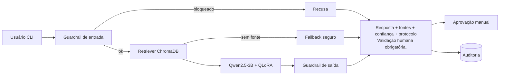

## Tech Challenge — Fase 3 — FIAP

**Curso:** IA Para Devs

**Projeto:** Assistente Médico Virtual Hospitalar

**Autor:** Victor Luiz Domingues

**RM:** rm375278

**Grupo:** 38

**Data:** 2026

---

## Assistente Médico Virtual Hospitalar

Protótipo acadêmico de um assistente virtual para apoio **informacional** em contexto hospitalar, desenvolvido com IA generativa, fine-tuning experimental (QLoRA), RAG e LangChain. O projeto demonstra recuperação de protocolos, respostas com fontes e fluxos administrativos com dados sintéticos. **Não é um dispositivo médico, não diagnostica, não prescreve e não substitui profissionais de saúde.**

Apesar de o tema ser assistência hospitalar, este repositório **não utiliza dados próprios de um hospital nem dados reais de pacientes**: protocolos e registros demonstrativos são sintéticos, e os datasets públicos são usados apenas como fontes não curadas de RAG.

**Execução principal:** o projeto é apresentado no notebook único [IADT 3 - Victor Luiz Domingues.ipynb](IADT%203%20-%20Victor%20Luiz%20Domingues.ipynb), na raiz deste repositório. A implementação Python, os dados e as dependências estão em [`medical-ai-assistant/`](medical-ai-assistant/); o notebook utiliza essa pasta e não é autocontido.


## Vídeo explicativo

Veja o vídeo explicativo no YouTube:

[](https://youtube.com)

---

## Relatório Técnico

Consulte o [relatório técnico](medical-ai-assistant/docs/relatorio_tecnico.md) para detalhes de arquitetura, implementação e limitações.

---

## Sumário

1. [Visão geral](#visão-geral) · 2. [Arquitetura](#arquitetura) · 3. [Estrutura](#estrutura) · 4. [Instalação](#instalação) · 5. [Execução](#execução) · 6. [Treinamento](#treinamento-fine-tuning-qlora) · 7. [Avaliação](#avaliação) · 8. [Testes](#testes) · 9. [Segurança e privacidade](#segurança-e-privacidade) · 10. [Limitações](#limitações)

## Visão geral

| Requisito | Onde está |
|---|---|
| Fine-tuning comportamental QLoRA do `Qwen/Qwen2.5-3B-Instruct` (Colab) | [Notebook único](IADT%203%20-%20Victor%20Luiz%20Domingues.ipynb), [`train_qlora.py`](medical-ai-assistant/src/finetuning/train_qlora.py) |
| Pipeline PubMedQA/MedQuAD, limpeza e anonimização | [`scripts/`](medical-ai-assistant/scripts/), [`dataset.py`](medical-ai-assistant/src/finetuning/dataset.py), [`data/`](medical-ai-assistant/data/); conteúdo público é isolado de respostas de treino |
| RAG de protocolos, fontes públicas não curadas e anotações sintéticas autorizadas | [`src/rag/`](medical-ai-assistant/src/rag/), [notebook principal](IADT%203%20-%20Victor%20Luiz%20Domingues.ipynb) |
| SQLite: pacientes, médicos, agenda, propostas humanas e auditoria funcional | [`src/database/`](medical-ai-assistant/src/database/), [`data/sqlite/`](medical-ai-assistant/data/sqlite/) |
| Chat CLI e fluxos de perfil | [`main.py`](medical-ai-assistant/main.py), [`scripts/clinic_demo.py`](medical-ai-assistant/scripts/clinic_demo.py), [`src/assistant/`](medical-ai-assistant/src/assistant/) |
| Demonstração `clinic_demo.py` no Colab | Parte 6 do [notebook único](IADT%203%20-%20Victor%20Luiz%20Domingues.ipynb) |
| Chat interativo no Colab | Parte 7 do [notebook único](IADT%203%20-%20Victor%20Luiz%20Domingues.ipynb) |
| Guardrails de entrada e saída | [`guardrails.py`](medical-ai-assistant/src/security/guardrails.py) |
| Human-in-the-Loop ("Validação humana obrigatória.") | [`hitl.py`](medical-ai-assistant/src/assistant/hitl.py), [`cli.py`](medical-ai-assistant/src/assistant/cli.py) |
| Explicabilidade (documentos, confiança, protocolo) | [`explain.py`](medical-ai-assistant/src/assistant/explain.py) |
| Logging, auditoria e rastreabilidade | [`audit.py`](medical-ai-assistant/src/logging/audit.py) (`medical-ai-assistant/logs/`) |
| LangSmith | [`observability.py`](medical-ai-assistant/src/utils/observability.py) |
| Testes unitários, de integração e mocks | [`tests/`](medical-ai-assistant/tests/) |
| Arquitetura completa, relatório técnico, avaliação e plano de demo | [`docs/`](medical-ai-assistant/docs/) |

**Decisão central:** o **RAG versionado é a fonte de verdade** dos protocolos (citável, atualizável, rastreável). O **fine-tuning ensina comportamento** (formato, citação `[DOC-n]`, recusas), não conhecimento clínico: pesos não garantem atualização, proveniência nem citação.

## Arquitetura



Toda a orquestração é **LangChain (LCEL)**: `RunnableLambda`, `RunnableBranch`, `RunnablePassthrough.assign`, `ChatPromptTemplate`, `StrOutputParser`. Diagramas completos (assistente, médico, paciente, SQLite, RAG, fine-tuning, LangChain e HITL) em [docs/arquitetura.md](medical-ai-assistant/docs/arquitetura.md).

## Estrutura

Árvore dos arquivos do projeto e responsabilidade de cada parte. A execução acadêmica principal fica no notebook único da raiz; a aplicação Python, seus dados, scripts e testes estão em `medical-ai-assistant/`.

```text
.
├── README.md                                  # Apresentação, arquitetura, instalação e uso do projeto
├── IADT 3 - Victor Luiz Domingues.ipynb       # Notebook único para execução acadêmica no Colab
└── medical-ai-assistant/
    ├── .env.example                           # Modelo de variáveis de ambiente; não contém segredos
    ├── .gitignore                              # Exclui ambiente, banco, logs e artefatos locais
    ├── main.py                                 # Entrada principal da aplicação conversacional CLI
    ├── pytest.ini                              # Configuração de descoberta e execução do pytest
    ├── requirements.txt                        # Dependências da aplicação, RAG e testes
    ├── requirements-train.txt                  # Dependências adicionais de treino e datasets
    ├── artifacts/
    │   └── .gitkeep                            # Mantém o diretório; adaptadores e índices gerados não são versionados
    ├── data/
    │   ├── eval/
    │   │   └── eval_set.jsonl                  # Perguntas rotuladas para avaliar recuperação e segurança
    │   ├── processed/
    │   │   ├── train.jsonl                     # Split de treino para fine-tuning comportamental
    │   │   ├── validation.jsonl                # Split de validação do fine-tuning
    │   │   └── test.jsonl                      # Split de teste do fine-tuning
    │   ├── protocols/
    │   │   ├── prot_001_higienizacao_maos.md   # Protocolo sintético de higiene das mãos
    │   │   ├── prot_002_identificacao_paciente.md # Protocolo sintético de identificação
    │   │   ├── prot_003_prevencao_quedas.md    # Protocolo sintético de prevenção de quedas
    │   │   ├── prot_004_preparo_exames_imagem.md # Protocolo sintético de preparo para exames de imagem
    │   │   ├── prot_005_visitas_acompanhantes.md # Protocolo sintético de visitas e acompanhantes
    │   │   ├── prot_006_alta_hospitalar.md     # Protocolo sintético de alta hospitalar
    │   │   ├── prot_007_acionamento_enfermagem.md # Protocolo sintético de acionamento da enfermagem
    │   │   └── prot_008_privacidade_lgpd.md    # Protocolo sintético de privacidade
    │   ├── raw/
    │   │   └── README.md                       # Formatos, origem e cuidados para datasets públicos opcionais
    │   │                                        # Arquivos PubMedQA/MedQuAD baixados ficam locais e não são versionados
    │   ├── sqlite/
    │   │   └── .gitkeep                        # Mantém a pasta; bancos e chaves sintéticos locais são ignorados
    │   └── synthetic/
    │       ├── faqs.jsonl                      # Perguntas e respostas institucionais sintéticas
    │       ├── patients.json                   # Massa de pacientes fictícios para demonstrações
    │       └── refusals.jsonl                  # Exemplos sintéticos de solicitações que devem ser recusadas
    ├── docs/
    │   ├── arquitetura.md                       # Componentes, fluxos, persistência e decisões arquiteturais
    │   ├── plano_demonstracao.md                # Roteiro da demonstração acadêmica
    │   ├── plano_avaliacao.md                   # Métricas, procedimento e limites da avaliação
    │   └── relatorio_tecnico.md                 # Relatório técnico da implementação e limitações
    ├── logs/
    │   └── .gitkeep                            # Mantém a pasta; logs gerados não são versionados
    ├── scripts/
    │   ├── build_index.py                      # Cria ou atualiza explicitamente os índices Chroma
    │   ├── clinic_demo.py                      # Fluxos clínico-administrativos e cenários automatizados
    │   ├── download_public_datasets.py          # Download opcional de amostras PubMedQA e MedQuAD
    │   ├── evaluate.py                         # Executa avaliação integrada e salva relatório
    │   └── prepare_data.py                     # Limpa, anonimiza e prepara datasets/splits
    ├── src/
    │   ├── __init__.py                          # Identifica o pacote principal da aplicação
    │   ├── assistant/
    │   │   ├── __init__.py                     # Pacote de orquestração do assistente
    │   │   ├── assistant.py                    # Pipeline LangChain: guardrails, RAG, resposta e HITL
    │   │   ├── cli.py                           # Chat de terminal e tratamento de comandos
    │   │   ├── clinic_tools.py                  # Ferramentas administrativas vinculadas a identidade autorizada
    │   │   ├── explain.py                       # Renderiza fontes, confiança, protocolo e estado de revisão
    │   │   ├── factory.py                       # Constrói índices, retrievers e assistente
    │   │   ├── hitl.py                          # Fila de validação humana e auditoria de decisões
    │   │   └── record_intent.py                 # Reconhece pedidos explícitos de consulta a registros
    │   ├── database/
    │   │   ├── __init__.py                      # Pacote de persistência e autorização
    │   │   └── sqlite.py                        # Esquema SQLite, autenticação, escopo e operações administrativas
    │   ├── demo/
    │   │   ├── __init__.py                      # Pacote de demonstrações
    │   │   ├── guided_flows.py                  # Fluxos guiados de cadastro, agendamento e revisão
    │   │   ├── persistent_setup.py              # Inicializa perfis e massa sintética persistente da demonstração
    │   │   └── text_chat.py                     # Chat textual do notebook com perfis sintéticos
    │   ├── finetuning/
    │   │   ├── __init__.py                      # Pacote de preparação e treino
    │   │   ├── artifacts.py                     # Grava e valida metadados e adaptadores QLoRA
    │   │   ├── dataset.py                       # Limpeza, anonimização, validação e divisão dos dados de treino
    │   │   ├── evaluate.py                      # Avaliação funcional de respostas, citações e bloqueios
    │   │   └── train_qlora.py                   # Treina adaptador QLoRA para comportamento institucional
    │   ├── logging/
    │   │   ├── __init__.py                      # Pacote de auditoria
    │   │   └── audit.py                         # Logs locais e encadeamento de hashes
    │   ├── models/
    │   │   ├── __init__.py                      # Pacote de modelos e contratos
    │   │   ├── llm.py                           # Backend extrativo ou Qwen com adaptador
    │   │   └── schemas.py                       # Modelos Pydantic para respostas, fontes e pacientes
    │   ├── prompts/
    │   │   ├── __init__.py                      # Pacote de prompts
    │   │   └── templates.py                     # Instruções do assistente e formatação de contexto RAG
    │   ├── rag/
    │   │   ├── __init__.py                      # Pacote de recuperação de informação
    │   │   ├── embeddings.py                    # Carrega embeddings multilíngues
    │   │   ├── indexer.py                       # Sincroniza e valida índices Chroma com manifesto
    │   │   ├── loader.py                        # Lê protocolos versionados e calcula hashes
    │   │   ├── medication_sources.py             # Localiza referências sem fornecer instruções de medicação
    │   │   ├── patient_retriever.py              # Recupera anotações apenas após autorização SQLite
    │   │   ├── public_sources.py                 # Carrega fontes públicas não curadas com proveniência
    │   │   └── retriever.py                     # Recuperação, score, filtros e combinação de índices
    │   ├── security/
    │   │   ├── __init__.py                      # Pacote de segurança
    │   │   ├── anonymizer.py                    # Detecta e anonimiza identificadores pessoais brasileiros
    │   │   └── guardrails.py                    # Guardrails determinísticos de entrada e saída
    │   └── utils/
    │       ├── __init__.py                      # Pacote de utilitários
    │       ├── config.py                        # Configuração por variáveis de ambiente
    │       ├── observability.py                 # Integração opcional com LangSmith e redação de payloads
    │       └── patients.py                      # Carrega e pseudonimiza pacientes sintéticos
    └── tests/
        ├── __init__.py                          # Identifica o pacote de testes
        ├── conftest.py                          # Fixtures, embeddings e modelos determinísticos de teste
        ├── test_audit_hitl.py                   # Auditoria, fila e revisão humana
        ├── test_automated_clinic_demo.py         # Cenários automatizados e output da Parte 6
        ├── test_clinic_tools.py                 # Ferramentas administrativas e escopo autorizado
        ├── test_database.py                     # Persistência, autenticação, agenda e autorização
        ├── test_finetuning_data.py               # Limpeza, anonimização e preparação do fine-tuning
        ├── test_integration.py                  # Integração do assistente e fluxos conversacionais
        ├── test_notebook_text_chat.py            # Chat textual e fluxos do notebook
        ├── test_observability.py                 # Redação e configuração LangSmith
        ├── test_persistent_demo.py               # Inicialização, migração e massa da demo persistente
        ├── test_public_rag.py                   # Fontes públicas, citações e integração com notebook
        ├── test_rag.py                           # Indexação, validação, recuperação e proveniência
        └── test_security.py                      # Guardrails, PII e segurança das respostas
```

Arquivos gerados em `artifacts/`, `logs/`, `data/sqlite/` e datasets baixados em `data/raw/` são locais e ignorados pelo Git. `data/processed/public_sources.jsonl` também é produzido localmente quando os datasets públicos são preparados; preserve separadamente as fontes e faça backup quando necessário. `__pycache__/`, `.pytest_cache/`, `.venv/` e arquivos do sistema, como `.DS_Store`, são artefatos locais e não fazem parte da estrutura versionada.

## Instalação

### Google Colab — primeiro acesso

O notebook é a forma principal de executar a demonstração. Ele precisa dos arquivos de `medical-ai-assistant/` no Google Drive, no caminho exato `/content/drive/MyDrive/fiap/fase3/medical-ai-assistant`.

1. Abra o [notebook do projeto no repositório](IADT%203%20-%20Victor%20Luiz%20Domingues.ipynb) e importe-o no Google Colab; use **Arquivo → Salvar uma cópia no Drive** para guardar sua cópia de trabalho.
2. No Colab, selecione **Ambiente de execução → Alterar tipo de ambiente de execução → T4 GPU** e salve. A GPU pode depender da disponibilidade e dos limites da sua conta; confirme no notebook que aparece uma GPU CUDA antes de treinar.
3. Execute a primeira célula do notebook para montar o Drive. Em uma célula temporária, clone o repositório e copie somente a pasta da aplicação para o caminho esperado:

   ```python
   from pathlib import Path
   import shutil
   !git clone --depth 1 https://github.com/victorldomingues/pos_fiap_ia_fase3_tech_challenge.git /content/pos_fiap_ia_fase3_tech_challenge

   source = Path("/content/pos_fiap_ia_fase3_tech_challenge/medical-ai-assistant")
   target = Path("/content/drive/MyDrive/fiap/fase3/medical-ai-assistant")
   target.parent.mkdir(parents=True, exist_ok=True)
   shutil.copytree(source, target, dirs_exist_ok=True)
   assert (target / "src").is_dir(), f"Pasta da aplicação não encontrada em {target}"
   ```

   Faça essa cópia inicial antes de executar a seção **0. Ambiente**. Ela verifica `PROJECT_DIR` nesse local e instala `requirements-train.txt` e `requirements.txt`. Se a pasta já existir no Drive, não repita a cópia sem antes preservar seus dados e artefatos; os arquivos correspondentes podem ser atualizados.
4. (Opcional) Selecione o ícone de chave **Secrets** na barra lateral do Colab e crie:
   - `HF_TOKEN`: token de leitura do Hugging Face. O modelo Qwen e os datasets usados são públicos, então normalmente é possível baixar sem token; configure-o para autenticar-se no Hub se necessário. Habilite o acesso do notebook ao secret. Para disponibilizá-lo às bibliotecas Hugging Face, execute uma célula antes do download do modelo:

     ```python
     import os
     from google.colab import userdata

     hf_token = userdata.get("HF_TOKEN")
     if hf_token:
         os.environ["HF_TOKEN"] = hf_token
     ```

   - `LANGSMITH_API_KEY`: chave da sua conta LangSmith. É opcional e só é necessária para tracing na seção **3.6**; habilite o acesso do notebook ao secret. `LANGSMITH_PROJECT` não é segredo e, se não for definido, o notebook usa `medical-ai-assistant`.

   Não cole tokens no código ou em células salvas. Sem LangSmith, a demonstração funciona normalmente; o tracing fica desligado. Mesmo quando habilitado, o projeto omite inputs e outputs dos traces.

### Instalação local/CLI

Para executar fora do Colab, use Python 3.11+. Na raiz do repositório, entre em `medical-ai-assistant/`; os comandos das seções locais seguintes devem ser executados nesse diretório, salvo indicação diferente.

```bash
cd medical-ai-assistant
python -m venv .venv && source .venv/bin/activate
pip install -r requirements.txt          # inferência + testes
# opcional (treino/datasets públicos): pip install -r requirements-train.txt
cp .env.example .env                     # ajuste e carregue: set -a; source .env; set +a
```

## Execução

### Execução no Google Colab

Execute as células em ordem, começando pela seção **0. Ambiente**. Essa seção monta o Drive, valida o caminho dos arquivos e instala as dependências. A instalação e os downloads exigem conexão com a internet; em um runtime novo, a instalação de dependências se repete.

1. **Parte 1 — dados:** execute a preparação. Para usar o RAG público, na seção **1.2** mude `DOWNLOAD_PUBLIC = False` para `True` e execute a célula. Ela baixa amostras de PubMedQA e MedQuAD para `data/raw/`; `LIMIT` define o número máximo de registros de cada base. Depois execute **1.3**, que prepara `data/processed/public_sources.jsonl` e os splits de treinamento. As bases são públicas, não curadas e podem exigir tempo e espaço de armazenamento; verifique licenças e termos. Elas são usadas no RAG, não como respostas para o fine-tuning.
2. **Parte 2 — fine-tuning:** a seção **2.2** mantém `RUN_TRAINING = False` por padrão. Para treinar o Qwen2.5-3B-Instruct com QLoRA, confirme a GPU T4, execute a Parte 1 e então defina `RUN_TRAINING = True`. O primeiro treino baixa o modelo-base e pode levar um tempo significativo. O adaptador, tokenizer e metadados são gravados no Drive em `medical-ai-assistant/artifacts/qwen-qlora-adapter`. Confira se já há um adaptador antes de treinar: `OVERWRITE = True` permite sobrescrever artefatos existentes. Para seguir o fluxo padrão até **3.3**, é preciso ter um adaptador compatível: treine na primeira execução ou reutilize um já salvo. Em runtimes posteriores, mantenha o treino desligado e valide o adaptador na seção **2.3**, em vez de retreiná-lo.
3. **Parte 3 — RAG:** `USE_PUBLIC_RAG = True` na seção **3.1** exige que as duas bases tenham sido baixadas e preparadas nas seções **1.2** e **1.3**. Se não quiser usar fontes públicas, defina `USE_PUBLIC_RAG = False` antes de executar **3.1**. A primeira indexação baixa o modelo multilíngue de embeddings e sincroniza protocolos e, se habilitado, as fontes públicas. Execute **3.1** antes de **3.2** e **3.3**. O índice Chroma fica em `/content/medical-ai-assistant-index/chroma`, armazenamento temporário do runtime; após reiniciá-lo, execute novamente **3.1** para reconstruir o índice a partir dos dados preservados no Drive. Não é necessário acionar `rebuild=True` como rotina.
4. **Demonstração:** depois de inicializar o assistente na seção **3.3**, continue as partes desejadas. A **Parte 6** executa os cenários automatizados e imprime cada histórico no output do notebook; a **Parte 7** inicia o chat interativo. A seção **3.6** é opcional e só deve ser executada se `LANGSMITH_API_KEY` estiver configurada.

O Google Drive conserva os dados-fonte e o adaptador, mas não é um banco gerenciado. O índice em `/content` é efêmero por decisão: preserve `data/protocols`, os arquivos originais em `data/raw/`, o corpus processado e o adaptador no Drive. A disponibilidade de GPU e os limites de memória podem variar; se faltar memória, interrompa o treino e reduza a carga antes de tentar novamente.

### Execução local/CLI

```bash
python scripts/build_index.py            # ação explícita: indexa data/protocols no ChromaDB
python main.py --user usuario-01 --reviewer dra-demo
```

Fluxos fictícios de médico/paciente em SQLite (token administrativo de provisionamento deve vir do ambiente):

```bash
MED_DB_BOOTSTRAP_TOKEN='<segredo-local>' python scripts/clinic_demo.py --provision-doctor
python scripts/clinic_demo.py
```

O fluxo pede o perfil quando não há sessão e valida o perfil real pelo token, não pela opção escolhida. Cadastros exigem confirmação de uso exclusivo de dados sintéticos; o token do paciente/profissional é exibido uma vez. Agendamento exige um médico provisionado e horário ISO-8601 com fuso.

Para percorrer automaticamente os fluxos da demonstração sem autenticação manual:

```bash
python scripts/clinic_demo.py --automated-tests
```

O modo executa seis cenários com SQLite temporário, cobrindo as quatro opções do paciente, as nove opções do médico, cadastro, isolamento da agenda e uma credencial incompatível. Para cada cenário, imprime as entradas sintéticas e a saída completa da CLI diretamente no console/output do Colab, com credenciais e dados pessoais redigidos. Não grava transcript em arquivo. Usa respostas e embeddings determinísticos (sem baixar modelo nem acessar o banco persistente). Esse comando testa os casos de uso da CLI; a suíte unitária e de integração continua sendo executada separadamente com `python -m pytest`.

O primeiro `build_index` baixa o modelo de embeddings (`paraphrase-multilingual-MiniLM-L12-v2`). Sem o índice, `main.py` falha com instruções claras (nunca indexa silenciosamente). Alterou os protocolos? Rode `build_index.py` de novo (atualização incremental por hash) ou `--rebuild`.

**RAG público acadêmico:** no Colab, execute 1.2 e 1.3 com as duas bases, depois 3.1 com `USE_PUBLIC_RAG=True` e reinicialize o assistente em 3.3. As fontes públicas não curadas ficam em índice separado; cada resultado identifica dataset, registro e hash do conteúdo, não uma versão oficial. Não são protocolos institucionais nem evidência clínica validada. Similaridade e guardrails heurísticos não garantem relevância ou segurança; respostas exigem validação humana. Verifique licenças e termos antes de uso ou redistribuição.

Na CLI, após o download, a preparação e a indexação são explícitas:

```bash
python scripts/prepare_data.py --pubmedqa data/raw/pubmedqa.jsonl --medquad data/raw/medquad.jsonl
python scripts/build_index.py --with-public-sources
MED_PUBLIC_RAG_ENABLED=true python main.py --user usuario-01
```

O corpus processado e os arquivos originais devem ser preservados independentemente dos índices; mantenha backup. No Colab, a seção 0 configura o Chroma em `/content/medical-ai-assistant-index/chroma`, no disco local efêmero do runtime, e não no Drive. Ao iniciar um runtime novo, execute a seção 3.1 para recriar os índices a partir dos protocolos e do corpus preservados no Drive. Isso evita abrir os arquivos SQLite do Chroma sobre o Drive, cuja sincronização/locking pode deixar manifesto e vetores inconsistentes. Na CLI, configure o índice localmente e não use o Drive como armazenamento ativo concorrente. Com a opção desligada, o comportamento permanece restrito aos protocolos.

Com o RAG público habilitado, protocolos que atinjam o limiar têm prioridade; as bases públicas são consultadas como alternativa quando nenhum protocolo atinge o limiar. Fontes repetidas são deduplicadas pelo identificador. Similaridade não assegura que a fonte responda à pergunta: esse critério pode favorecer um protocolo irrelevante e precisa de avaliação e calibração.

Ao apresentar a resposta, o chat identifica as fontes efetivamente citadas com `[DOC-n]` e encerra com um aviso de que o conteúdo não é recomendação do agente e orienta procurar médico habilitado especializado. Documentos recuperados sem citação são apresentados como recuperados, não como fontes citadas. O aviso não substitui os guardrails de segurança, que continuam bloqueando dados pessoais, diagnóstico individual, prescrição e doses.

Para perguntas sobre dose, o assistente mantém a recusa e, quando identifica um único medicamento da lista limitada de termos conhecidos, busca referências cuja passagem recuperada o mencione literalmente. Mostra apenas metadados, nunca o conteúdo da passagem ou instruções de uso; não chama o modelo nessa etapa. Uma menção e sua similaridade não comprovam que a fonte responde à pergunta ou tenha validade clínica. Se não houver correspondência, informa a limitação; medicamentos fora da lista não são pesquisados por esse fluxo.

Se o chat retornar várias vezes o mesmo documento público para a pergunta sobre visitas, verifique se o Colab está usando a versão atual da pasta `medical-ai-assistant` no Drive. Depois de atualizar os arquivos, reinicie o runtime e execute as seções 0, 3.1 e 3.3 novamente; a seção 3.1 recria o índice local do runtime a partir das fontes. Na seção 3.2, a consulta de visitas deve recuperar `PROT-005` quando o índice e o modelo de embeddings forem os esperados; o protocolo contém horários **sintéticos**, não horários reais de uma instituição. O backend generativo pode produzir uma resposta diferente ou ser bloqueado pelo guardrail, mesmo quando recupera a fonte correta.

O índice é validado contra o manifesto: cada documento precisa ter ao menos um trecho no Chroma com o hash esperado. Isso identifica documentos inteiros ausentes ou desatualizados, mas não garante que todos os trechos ou vetores estejam íntegros. No Colab, a seção 0 agora aponta Chroma para armazenamento local do runtime, e a seção 3.1 sincroniza os índices a partir das fontes; não use `rebuild=True` como rotina nem apague os dados-fonte. Se houver inconsistência mesmo no caminho local exibido pela seção 3.1, preserve os documentos-fonte e investigue o ambiente antes de reconstruir. Na CLI, a reconstrução explícita continua disponível com `python scripts/build_index.py --rebuild --with-public-sources`.

Para investigar uma recuperação inesperada no Colab, após 3.1 execute:

```python
from src.rag.retriever import ProtocolRetriever

index.validate()
protocolos = ProtocolRetriever(index, settings.top_k, settings.min_confidence)
for doc in protocolos.retrieve("Qual é o horário de visitas?"):
    print(doc.doc_id, doc.score, doc.source_type)
print("Limiar:", settings.min_confidence)
```

Se `PROT-005` aparecer abaixo do limiar ou não aparecer, esses dados ajudam a investigar o índice e os embeddings; não significam que se deva simplesmente baixar o limiar. A validação não identifica, por si só, a causa de falhas de similaridade ou da geração.

**Demonstração no Colab (com dados e adaptador já preparados):** execute as seções 0, 3.1, 3.3 e 5. A Parte 6 roda automaticamente seis cenários de `clinic_demo.py`, sem prompts interativos, em SQLite temporário; mostra o transcript redigido diretamente no output do notebook e não altera o SQLite persistente da Parte 5. Essa demonstração cobre os casos de uso da CLI, mas não executa `pytest`. Depois, se desejado, inicie o chat interativo na Parte 7. Para a primeira execução, siga antes a ordem completa descrita em [Execução no Google Colab](#execução-no-google-colab).

No agendamento, dados inválidos são solicitados novamente sem sair da etapa; ao concluir, o chat indica como consultar `/agenda`. Perguntas curtas como “o que eu faço agora?” recebem orientação sobre o último agendamento na sessão, sem enviar a pergunta ao RAG. Datas isoladas fora do formulário são tratadas como entrada fora de contexto, não como perguntas médicas.

As listas de agenda, profissionais e registros são numeradas para leitura e não selecionam itens automaticamente. Para escolher um profissional, use `/agendar` e informe o número quando solicitado. Nas listas de seleção dos fluxos guiados, o número corresponde ao item exibido; fora dessas etapas, números correspondem às opções do menu. Use `/menu` para rever as opções.

Após selecionar o perfil, o chat identifica o paciente ou médico sintético ativo. As telas autorizadas do chat mostram nome, data de nascimento e observação administrativa, enquanto CPF, telefone e e-mail continuam mascarados. Esses dados também são pessoais: use apenas dados sintéticos e remova as saídas antes de compartilhar o notebook. As funções do SQLite continuam mascarando nomes e data de nascimento por padrão; o chat solicita a exibição após verificação de credencial e vínculo.

- **Paciente:** `/profissionais`, `/agenda`, `/registros`, `/buscar` e `/agendar`. O agendamento é para si, exige data com fuso e confirmação.
- **Médico:** `/agenda`, `/registros`, `/buscar`, `/anotar`, `/proposta`, `/revisar`, `/auditoria` e `/cadastrar-paciente` (opção 8). `/validacoes` lista respostas pendentes com pergunta, resposta e fontes; `/aprovar-validacao <id>` registra a revisão pelo ID autenticado do médico e audita a decisão. Respostas sem conteúdo de revisão disponível não podem ser aprovadas. A aprovação marca a revisão demonstrativa como concluída, não torna a resposta recomendação clínica. O formulário de cadastro pede nome, CPF, nascimento (DD/MM/AAAA), telefone e e-mail fictícios e observação administrativa opcional sem dados pessoais; o identificador é gerado automaticamente. Confirme o uso exclusivamente sintético e o cadastro. Após `/trocar`, escolha o perfil paciente e selecione o novo cadastro para agendar sua própria consulta. O cadastro não cria vínculo: o médico só acessa registros após um agendamento com ele. Anotações e propostas são escritas pelo profissional, sem geração por IA; uma proposta só pode ser revisada por outro médico com acesso ao paciente.
- **Busca de anotações:** índice temporário criado somente após autorização, sem alterar o índice de protocolos. A similaridade não comprova relevância. A Parte 4.4 é uma demonstração separada.

O SQLite verifica credencial e vínculo em cada operação; a seleção de perfil não é autenticação institucional. Na demonstração, `/agenda` do paciente retorna somente agendamentos do próprio paciente autenticado; no perfil médico, lista pacientes agendados com aquele profissional, sem expandir o acesso para agendas de outros médicos. A base inicial contém dois pacientes sintéticos com agendamentos distintos. Os registros disponíveis **não constituem um prontuário completo**. Na Parte 5, o banco sintético fica em `medical-ai-assistant/data/sqlite/notebook_demo.sqlite3` no Drive; opcionalmente configure `MED_DEMO_DATABASE_PATH` com caminho absoluto no Drive antes da célula. A inicialização atualiza a base de demonstração antiga com um segundo paciente/agendamento sem apagar cadastros ou revisões existentes.

Na primeira execução, a Parte 5 gera automaticamente uma chave aleatória e a reutiliza nas próximas execuções, sem solicitar sua digitação. Ela fica em um arquivo `.demo-key` ao lado do banco, ignorado pelo Git, sem ser exibida no notebook. Proteja o arquivo e faça backup independente dele e do banco; quem tem acesso à chave pode usar os perfis sintéticos iniciais. Para banco criado antes desta alteração, informe a chave anterior uma única vez: ela é validada antes de ser guardada. Uma chave incorreta não substitui as credenciais existentes. Se a chave for perdida, esses perfis não poderão ser recuperados por este fluxo. O banco contém apenas dados sintéticos.

**Limitação:** a persistência do banco não recupera credenciais dos pacientes cadastrados pelo médico. Elas ficam apenas na memória do chat; ao encerrá-lo, os cadastros e consultas continuam no banco, mas esses pacientes não podem ser selecionados novamente por esse fluxo. O formulário e a entrada do Colab podem ficar visíveis na sessão: não insira dados reais. Não execute mais de um runtime sobre o mesmo SQLite no Drive; o Drive não garante integridade, concorrência ou recuperação. Faça backups independentes com o banco fechado e teste a restauração. Treinamento, avaliação e indexação permanecem nas etapas próprias ou na CLI; não são iniciados automaticamente pelo chat. Limpar saídas do notebook não remove auditoria nem revisões pendentes.

A Parte 6 chama `scripts/clinic_demo.py --automated-tests` sem entrada manual, mostra no output cada cenário com entradas e histórico da CLI redigidos e usa banco temporário, sem gravar logs em arquivo. A Parte 7 chama [src/demo/text_chat.py](medical-ai-assistant/src/demo/text_chat.py) para o chat interativo com as identidades da Parte 5. No Colab, mantenha a pasta `medical-ai-assistant` atualizada junto com o notebook.

**Backends de LLM** (`MED_LLM_BACKEND`):
- `extractive` (padrão): determinístico, sem GPU, devolve trechos do protocolo com citação. Para demo/testes.
- `hf`: Qwen2.5-3B-Instruct (4 bits em GPU) + adaptador QLoRA de `MED_ADAPTER_DIR` (validado ao iniciar; `MED_USE_ADAPTER=false` usa só o modelo-base).

**Comandos na CLI:** `/pendentes`, `/aprovar <id> [nota]`, `/rejeitar <id> <motivo>`, `/auditoria`, `/ajuda`, `/sair`. Aprovar/rejeitar exige `--reviewer`. A fila de validação do assistente persiste a pergunta anonimizada, a resposta e os trechos de fonte necessários para revisão no arquivo local `logs/approvals.jsonl`; trate esse arquivo como conteúdo informacional sensível, use apenas dados sintéticos e mantenha retenção limitada. O log geral de interações registra estado, origem, perfil e metadados minimizados, sem pergunta ou resposta.

O SQLite usa `MED_DATABASE_PATH` (padrão `data/sqlite/medical_assistant.sqlite3`). Para protótipo, esse caminho pode apontar ao Drive montado, mas use um único processo e mantenha backup restaurável. O diretório e os arquivos do banco são ignorados pelo Git.

Propostas clínicas são escritas pelo profissional, nunca geradas/completadas por IA, e ficam pendentes até outro profissional autenticado revisar. A ferramenta `prescription_tool` só lista metadados; não há prescrição autônoma.

Exemplo de saída:

```
Assistente: Segundo o protocolo recuperado: As visitas ocorrem diariamente das 14h às 16h ... [DOC-1]

─── Explicabilidade ───
Protocolo utilizado: PROT-005 v1.1 — Visitas e Acompanhantes (procedimento sintético)
Confiança da recuperação: 0.62 (alta)
Documentos recuperados:
  [DOC-1] PROT-005 v1.1 (2025-02-20) — ... | score 0.62
Revisão humana: PENDENTE
⚠ Validação humana obrigatória.
```

## Treinamento (fine-tuning QLoRA)

1. **Ambiente:** abra o [notebook único](IADT%203%20-%20Victor%20Luiz%20Domingues.ipynb) no Colab e copie `medical-ai-assistant/` para o Drive. Na seção 0, ajuste `PROJECT_DIR` para o caminho real dessa pasta. Localmente, inicie o kernel na raiz do repositório ou em `medical-ai-assistant/`, ou ajuste `PROJECT_DIR`.
2. **Dados:** execute a Parte 1 para gerar `data/processed/{train,validation,test}.jsonl`; o download público é opcional e PubMedQA/MedQuAD servem somente ao RAG, não devem gerar exemplos de recusa de fine-tuning. Regenere os splits após alterações de prompt para não treinar mensagens de sistema antigas. Alternativamente, em `medical-ai-assistant/`, use `python scripts/prepare_data.py`.
3. **Treino e reuso:** para treinar na seção 2.2, selecione GPU (T4 ou superior) e defina `RUN_TRAINING = True`. Se o adaptador já estiver salvo e não quiser retreinar, defina `RUN_TRAINING = False`; na seção 2.3 valide o adaptador em `ADAPTER_DIR`. A seção 2.4 avalia o adaptador com GPU. Treinar sobre um adaptador existente exige `OVERWRITE = True`.
4. **RAG:** execute a Parte 3 para indexar os protocolos e experimentar o assistente. O backend `extractive` é o padrão; para usar o adaptador, configure `MED_LLM_BACKEND=hf` e, se necessário, `MED_ADAPTER_DIR` antes de criar `Settings()`.
5. **Alternativa por script:** dentro de `medical-ai-assistant/`, use `pip install -r requirements-train.txt` e `python -m src.finetuning.train_qlora --train data/processed/train.jsonl --validation data/processed/validation.jsonl --output-dir <pasta-persistente>`. O script exige `--overwrite` para sobrescrever um adaptador.

O adaptador, o tokenizer e `training_metadata.json` (modelo-base, hiperparâmetros e hash do dataset) são salvos em `ADAPTER_DIR`; no Colab, mantenha essa pasta no Drive, pois `/content` é efêmero. O padrão de respostas é português brasileiro (pt-BR), inclusive para fontes em inglês. O modo `extractive` não traduz: se não puder responder em português com segurança, o assistente recusa em português em vez de reproduzir texto estrangeiro. Com `extractive`, é possível pular a Parte 2 e seguir para a Parte 3 sem adaptador ou GPU.

Configuração padrão: NF4 4 bits com dupla quantização, LoRA `r=16, alpha=32, dropout=0.05` em `q,k,v,o,gate,up,down`, 3 épocas, `lr=2e-4`, *loss* só na resposta. A Parte 2 do notebook único mantém o treinamento desligado por padrão e grava adaptadores em armazenamento persistente do Drive. Limites: o Drive não é banco gerenciado; faça backup e teste restauração. Preserve `data/protocols`, os datasets originais e o corpus processado para reconstruir os índices.

## Avaliação

`python scripts/evaluate.py` calcula recall de bloqueio, acerto de categoria, falso bloqueio, hit@k/top-1 da recuperação, taxa de HITL e saídas inseguras (`logs/eval_report.json`). Plano completo (métricas, metas, red-team, critérios de aceite) em [docs/plano_avaliacao.md](medical-ai-assistant/docs/plano_avaliacao.md). Roteiro da apresentação em [docs/plano_demonstracao.md](medical-ai-assistant/docs/plano_demonstracao.md).

## Testes

```bash
python -m pytest
```

Cobrem: autorização e isolamento SQLite, mascaramento, agenda, autoria humana e revisão, recuperação pessoal após autorização, anonimização, guardrails, auditoria, HITL, Chroma, pipeline de dados, QLoRA, LangSmith e integração CLI. Dados/mocks eliminam GPU; algumas dependências de teste ainda precisam ser instaladas.

## Segurança e privacidade

- **Guardrails de entrada:** bloqueiam PII (CPF, CNS, telefone, e-mail, RG, prontuário, nome com pista contextual), pedidos de diagnóstico, prescrição e dose — antes de recuperação e LLM.
- **Guardrails de saída:** bloqueiam doses, nomes de fármacos sugeridos, afirmações de diagnóstico e PII; substituem por recusa segura.
- **RAG como dado não confiável:** o prompt isola o contexto e trechos com instruções embutidas são descartados.
- **Sem fonte confiável → sem resposta** (limiar `MED_MIN_CONFIDENCE`); o LLM não é chamado.
- **HITL:** respostas clínicas nascem `PENDENTE` com "Validação humana obrigatória."; aprovação exige revisor identificado e é auditada.
- **Auditoria:** `logs/audit.jsonl` e `logs/approvals.jsonl` com hash encadeado, estado, fontes e identificadores não sensíveis; sem pergunta, resposta ou nota clínica. Detecta adulteração; **não** é imutável.
- **LangSmith:** desligado por padrão; mesmo habilitado, inputs/outputs são omitidos e somente metadados de estrutura são rastreados. `MED_LANGSMITH_SEND_CONTENT` não habilita exportação de conteúdo. Use dados sintéticos e chave por ambiente/Secrets.
- **SQLite:** tokens são credenciais bearer locais, verificados a cada operação; saídas mascaram identificadores e médicos são limitados à sua agenda. Isto não equivale a autenticação institucional.
- **Dados:** somente sintéticos; `logs/`, `artifacts/` e `data/raw/` não são versionados; segredos nunca no código (`.env` ignorado).

No Colab, configure o secret `LANGSMITH_API_KEY` e execute a seção 3.6 antes do chat. Ela define `MED_LANGSMITH_ENABLED=true`, lê a chave do secret e usa `LANGSMITH_PROJECT` (padrão `medical-ai-assistant`). O projeto usa um callback explícito, não o tracing global: a confirmação do callback não comprova o recebimento remoto; verifique os traces no LangSmith após uma pergunta.

## Limitações

- Protótipo acadêmico: sem validação clínica, regulatória ou de conformidade LGPD; **não pronto para produção**.
- Guardrails por regex têm falsos positivos/negativos (paráfrases, erros de digitação, idiomas, PII sem pista). Reforçar com classificador validado e red-team contínuo.
- Anonimização por regras não é completa (nomes sem contexto, endereços, dados indiretos).
- Protocolos sintéticos e corpus público não curado; fine-tuning é apenas demonstrativo e PubMedQA/MedQuAD não treinam respostas clínicas. Confira licença antes de usá-los;
- A confiança é similaridade de cosseno do melhor trecho, **não** probabilidade de correção; o limiar padrão (0,35) deve ser calibrado com o modelo de embeddings escolhido. Medição real (MiniLM multilíngue, 26 itens de `data/eval/eval_set.jsonl`): perguntas em escopo ficaram em 0,25–0,75 e uma pergunta fora de escopo (N01) obteve 0,56; portanto um limiar de similaridade sozinho não separa fora de escopo (`no_source_correct` = 0,5, `retrieval_hit_at_k` = 0,87). Melhorias possíveis: reranker, verificação de suporte da resposta ou corpus maior.
- O LLM pode errar mesmo com contexto; por isso há revisão humana e filtros de saída.
- Chroma/SQLite no Drive: sem controle de concorrência gerenciada; um processo por vez. Tokens locais do protótipo não são autenticação corporativa.
- Backend `extractive` não representa a qualidade do modelo fine-tunado.
