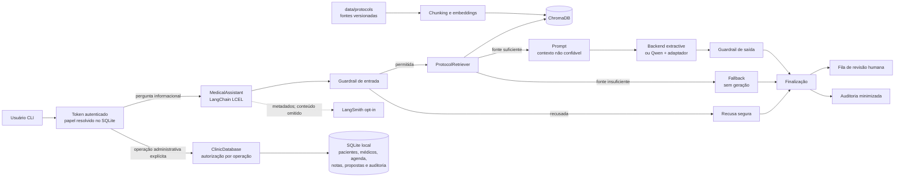
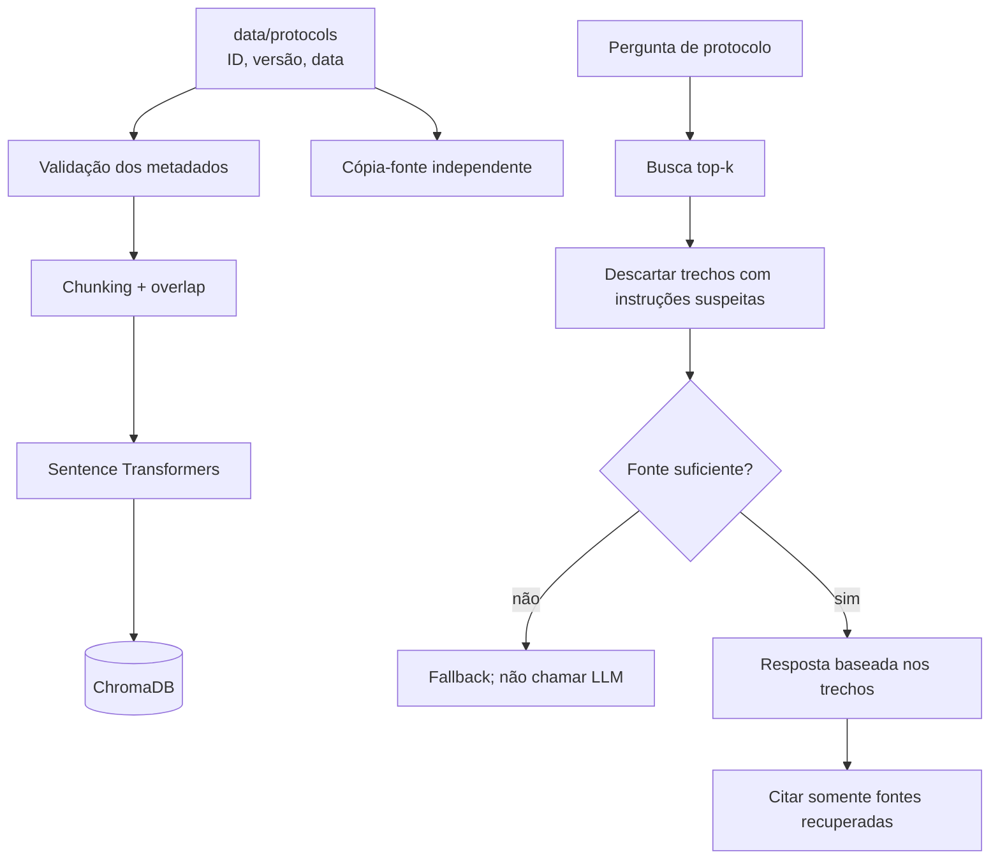
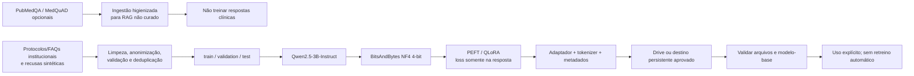
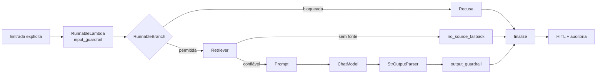
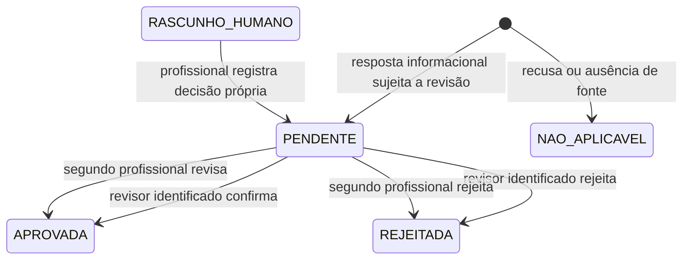

# Arquitetura completa — Assistente Médico Virtual Acadêmico

## Escopo

Projeto acadêmico informacional, executado pelo notebook único `IADT 3 - Victor Luiz Domingues.ipynb`, na raiz, e pela CLI. Todas as demonstrações no Colab, inclusive fine-tuning, permanecem nesse notebook. Não é dispositivo médico nem sistema para uso clínico. O modelo não diagnostica, faz triagem, recomenda tratamento ou medicamentos, gera/completa prescrições nem decide condutas. Prescrições e anotações persistidas são textos sintéticos de autoria humana, com revisão humana quando aplicável.

O SQLite verifica a credencial e a autorização em cada operação. A seleção de perfil é apenas experiência de uso: a autorização deriva do token autenticado e do escopo de agenda registrado, não do papel digitado nem de instruções ao LLM. O protótipo não autentica pessoas por identidade civil e não deve receber dados reais de pacientes.

Na Parte 6 do notebook, `scripts/clinic_demo.py` demonstra fluxos administrativos sobre o SQLite e os perfis sintéticos da Parte 5. Na Parte 7, pedidos de prontuário ou anotação são encaminhados aos comandos explícitos de registros, usando as mesmas identidades. O paciente consulta as próprias anotações; o médico vinculado consulta os dados mascarados, agendamentos, anotações e propostas humanas existentes para o paciente. A leitura é direta no SQLite, sem enviar os registros ao modelo ou ao LangSmith, e não altera as ferramentas de prescrição do agente. A base não contém exames, histórico externo ou outros componentes necessários para representar um prontuário completo. A Parte 4.4 é uma demonstração separada, com autorização simulada, e não alimenta essa consulta.

No chat da Parte 7, somente uma sessão médica autenticada pode consultar `/validacoes` e aprovar `/aprovar-validacao <id>`. A aprovação registra o identificador do médico nos logs de revisão e auditoria; não transforma a saída do modelo em recomendação clínica. Para permitir revisão informada, `logs/approvals.jsonl` persiste a pergunta anonimizada, a resposta e os trechos recuperados. Use exclusivamente dados sintéticos, proteja esse arquivo e aplique retenção limitada. Solicitações antigas sem conteúdo de revisão permanecem pendentes, mas não podem ser aprovadas pelo chat.

A agenda é sempre filtrada no serviço SQLite: paciente consulta somente agendamentos com seu próprio `patient_id`; médico consulta os pacientes agendados com o `doctor_id` autenticado, sem acesso às agendas de outros profissionais. A massa inicial da demonstração contém dois pacientes sintéticos com agendamentos próprios para tornar esse isolamento observável. Bases persistentes existentes são migradas aditivamente para incluir o segundo paciente e seu agendamento, sem apagar os dados anteriores.

O RAG público acadêmico é opcional e explicitamente habilitado: PubMedQA e MedQuAD normalizados são indexados em diretório separado dos protocolos, com ID de registro e hash de conteúdo. A pergunta e a resposta original são colocadas antes do contexto longo para favorecer a recuperação do achado dentro do limite de chunk. O campo de aprovação permanece falso: são fontes públicas não curadas, não protocolos nem evidência clínica validada. O retriever prioriza protocolos acima do limiar e consulta fontes públicas como alternativa, deduplicando por fonte e ID. Similaridade não prova relevância, e essa prioridade pode levar à seleção de um protocolo irrelevante. Perguntas gerais sobre sintomas ou condições não são, por si só, pedidos de diagnóstico; quando há trecho pertinente, a resposta pode relatar o achado em português brasileiro e citar a fonte. Todas as respostas e recusas devem ser exibidas em pt-BR. Para respostas geradas em outro idioma, o assistente tenta uma tradução fiel e revalida segurança e citações; o modo extrativo, que não traduz, recusa uma resposta em língua estrangeira em vez de exibi-la sem tradução. A detecção de idioma é heurística e não garante identificação de todas as línguas. Trechos com PII, instruções de tratamento ou instruções embutidas são filtrados; menções factuais a medicamentos e doses podem ser recuperadas e relatadas somente como achados da fonte, sem personalização ou orientação ao usuário. Se a geração pública for vazia, uma recusa genérica, insegura ou sem citação válida, tenta-se extração determinística do trecho pertinente; se não houver correspondência ou se os guardrails também bloquearem o trecho, a resposta é recusada. Esses filtros não garantem segurança clínica. O conteúdo é tratado como não confiável, não é exibido na seção de trechos e as respostas requerem validação humana. A renderização termina com aviso de que o conteúdo não é recomendação do agente. Fontes originais e corpus processado devem ser preservados e ter backup separado dos índices.

## Componentes e fluxo do assistente



```mermaid
sequenceDiagram
    actor U as Usuário
    participant C as CLI
    participant A as MedicalAssistant / LCEL
    participant R as Retriever
    participant L as LLM
    participant H as Revisor humano
    participant AU as Auditoria
    U->>C: Pergunta sem dados pessoais
    C->>A: ask(pergunta, perfil autenticado)
    A->>A: Guardrail de entrada
    alt Bloqueada
        A-->>C: Recusa categorizada
    else Permitida
        A->>R: Buscar protocolos
        R-->>A: Trechos + ID, versão, data e score
        alt Sem fonte confiável
            A-->>A: Fallback; não chama LLM
        else Fonte suficiente
            A->>L: Contexto isolado como dado não confiável
            L-->>A: Rascunho
            A->>A: Guardrail de saída
        end
    end
    A->>AU: Registrar fonte, perfil, estado e metadados mínimos
    A-->>C: Resposta + fontes + limitação + revisão
    opt Revisão necessária
        C->>H: Solicitar validação humana
        H->>AU: Registrar revisor e decisão
    end
```

## Fluxo do médico

```mermaid
sequenceDiagram
    actor M as Profissional fictício
    participant C as CLI/serviço
    participant DB as ClinicDatabase
    participant R as RAG institucional
    participant AU as audit_logs
    M->>C: Apresenta token de acesso
    C->>DB: Autenticar; papel deriva do token
    M->>C: Solicita agenda, paciente ou protocolo
    C->>DB: Autorizar e conferir vínculo de agenda
    DB-->>C: Dados autorizados e mascarados
    C->>AU: Registrar perfil, ação, instante e resultado
    opt Registrar proposta clínica
        M->>C: Escreve a própria proposta fictícia, sem identificadores
        C->>DB: Grava pending_review; não chama LLM
        M-->>C: Outro profissional autenticado revisa
        C->>DB: Confere escopo e revisor distinto; registra decisão
    end
```

O médico consulta a própria agenda, protocolos e pacientes ligados ao seu escopo autorizado. Anotações clínicas só podem ser escritas por profissional autenticado e são recuperadas por RAG temporário, após autorização no SQLite. A aprovação de uma proposta exige revisor distinto.

**Limite deliberado:** “IA sugere prescrição” é incompatível com a regra de não inventar, completar ou aprovar decisões clínicas. Não há ferramenta que gere prescrições. O `prescription_tool` LangChain é somente leitura; a gravação é uma ação explícita do profissional.

## Fluxo do paciente

```mermaid
sequenceDiagram
    actor P as Paciente fictício
    participant C as CLI/serviço
    participant DB as SQLite
    participant A as Assistente informacional
    P->>C: Confirma uso exclusivo de dados sintéticos
    C->>DB: Cadastra e gera token aleatório
    DB-->>P: Token exibido uma vez; somente hash persistido
    P->>C: Autentica com token
    C->>DB: Resolve identidade/perfil pela credencial
    P->>C: Lista profissionais, agenda ou consulta a própria agenda
    C->>DB: Verifica credencial e restringe operação ao próprio ID
    P->>A: Pergunta geral
    A-->>P: Informação citada, recusa ou limitação de fonte
    Note over P,A: Sem diagnóstico, triagem, prescrição ou prontuário de terceiros
```

Cadastro é uma demonstração local, não uma verificação de identidade. O paciente só consulta os próprios registros. O disclaimer informacional é apresentado no fluxo CLI.

## Fluxo do RAG



Protocolos são estáticos e versionados. Anotações pessoais ficam em SQLite separado; recuperação dinâmica autentica e autoriza o acesso antes de carregar qualquer nota para embeddings. O índice de notas é efêmero e em memória, sem persistir vetores ou conteúdo pessoal. O índice Chroma de protocolos é reconstruível a partir de `data/protocols/`.

## Fluxo do Fine-Tuning



Fine-tuning ensina comportamento estável: formato, tom institucional, resposta informacional baseada em fonte e recusas para pedidos clínicos individualizados. Não é memória clínica. PubMedQA/MedQuAD são opcionais e sujeitos a licença; não geram exemplos de recusa de SFT nem entram nos splits de treino, pois as respostas clínicas permanecem exclusivamente no RAG. Após atualizar o prompt ou exemplos, regenere os splits antes de treinar para não reutilizar mensagens de sistema antigas. Artefatos não devem depender de `/content`, que é efêmero.

## Fluxo LangChain



A aplicação usa LCEL e ramificações explícitas, não um agente autônomo com permissões de escrita. As ferramentas `appointment_tool`, `patient_tool`, `protocol_tool`, `rag_tool` e `prescription_tool` são adaptadores associados a uma identidade autenticada. Operações mutáveis exigem confirmação e chamada direta do serviço; não são expostas ao LLM como ações autônomas.

## Fluxo Human In The Loop



Saída gerada não é uma decisão aprovada. Respostas informacionais usam fila de revisão. Propostas fictícias escritas por médico usam a tabela SQLite e exigem revisão por outro profissional.

## Banco, logging e LangSmith

| Informação | Persistência | Controle |
|---|---|---|
| Pacientes e médicos sintéticos | SQLite `data/sqlite/` | Token aleatório com SHA-256; perfil resolvido no banco; campos mascarados ao exibir |
| Agendamentos | SQLite | Paciente apenas próprio; médico apenas agenda própria; unicidade de horário |
| Notas e propostas | SQLite | Somente autoria humana; escopo médico verificado; texto clínico não vai à auditoria |
| Auditoria funcional | SQLite | Timestamp, usuário sintético, perfil, ação e resultado |
| Interações do assistente | `logs/audit.jsonl` | Fontes, estado e metadados; sem pergunta/resposta |
| Protocolos/índice | `data/protocols/`, `artifacts/chroma/` (CLI); `/content/medical-ai-assistant-index/chroma` (Colab) | Fontes preservadas fora do índice; no Colab, o índice Chroma usa disco local efêmero e é recriado no runtime novo |
| Adaptador | `artifacts/models/` ou Drive | Metadados e modelo-base validados antes do uso |
| Traces LangSmith | Opt-in | Inputs/outputs omitidos; somente metadados estruturais |

`MED_DATABASE_PATH` pode apontar para um diretório persistente do Drive. Drive é armazenamento de protótipo, não banco gerenciado; concorrência, integridade e backup/restauração não são garantidos. Use um processo por vez.

LangSmith pode registrar execução de chains, retriever e ferramentas sem enviar corpos de inputs/outputs. `MED_LANGSMITH_SEND_CONTENT` não habilita conteúdo. O tracing continua sendo opt-in e deve usar dados sintéticos.

## Decisões e limitações

- RAG versionado é fonte de verdade; fine-tuning não contém fatos clínicos mutáveis.
- Guardrails regex são determinísticos, mas podem gerar falsos positivos/negativos.
- Similaridade vetorial mede proximidade, não correção clínica.
- Tokens SQLite são bearer credentials locais; não há MFA, expiração, recuperação de conta ou integração a identidade institucional.
- Máscaras por regex não garantem detecção completa de PII. Não use dados reais.
- O SQLite do banco e o Chroma ativo não devem operar diretamente sobre o Drive do Colab: sincronização/locking pode deixar arquivos inconsistentes. No notebook, use `/content` para Chroma e reconstrua-o a partir dos documentos-fonte preservados no Drive; o armazenamento local do runtime é efêmero.
- A configuração não comprova conformidade regulatória, segurança clínica certificada ou prontidão para produção.
